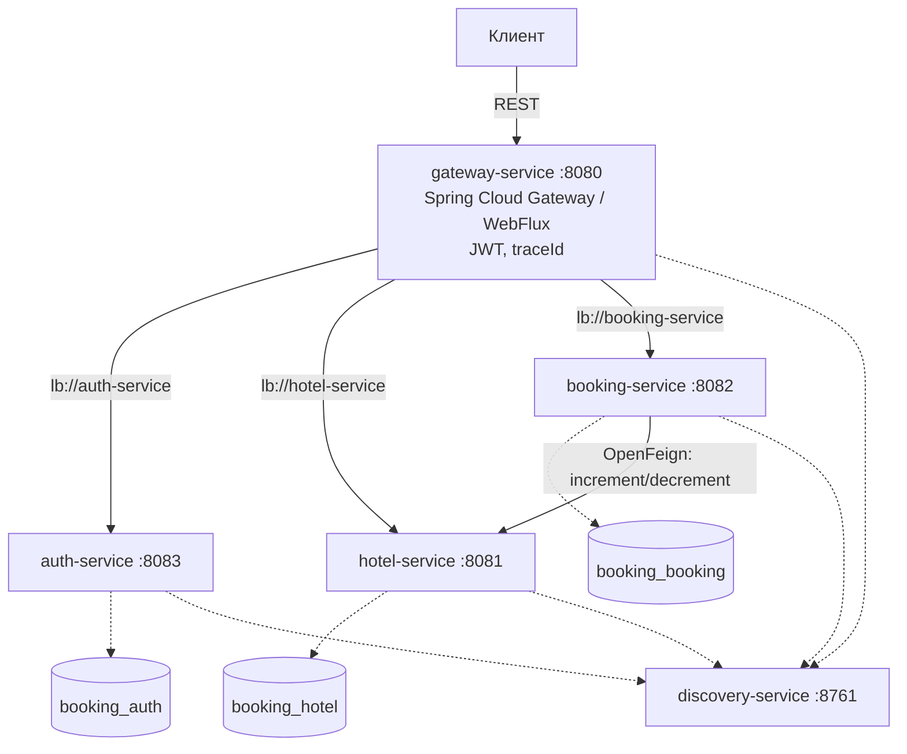

# Booking System

Микросервисная система бронирования отелей на Spring Boot 3.2.5 и Spring Cloud 2023.0.1. Реализована распределённая обработка бронирований с гарантиями согласованности между сервисами, защитой от конкурентного overbooking и идемпотентной обработкой повторных запросов.

## Содержание

- [Обзор](#обзор)
- [Архитектура](#архитектура)
- [Сервисы](#сервисы)
- [Технологический стек](#технологический-стек)
- [Развёртывание](#развёртывание)
- [Тестовые данные](#тестовые-данные)
- [Тестирование](#тестирование)
- [HTTP API](#http-api)
- [Swagger UI](#swagger-ui)
- [Формат ошибок](#формат-ошибок)
- [Архитектурные решения](#архитектурные-решения)
- [Структура репозитория](#структура-репозитория)

## Обзор

Система реализует три ключевых аспекта распределённого бронирования:

1. **Согласованность данных** между сервисами достигается через сагу с компенсацией. Бронирование создаётся в состоянии `PENDING`, подтверждается только после успешного резервирования номера в `hotel-service`, а при сбое downstream-вызова переводится в `CANCELLED`. Взаимодействие защищено `Retry`, `Timeout` и `CircuitBreaker`.

2. **Защита от конкурентного overbooking** обеспечивается декларативным ограничением на уровне PostgreSQL (`EXCLUDE USING gist`), что исключает возможность двух активных броней одного номера на пересекающиеся даты независимо от количества одновременных запросов.

3. **Идемпотентность** создания брони реализована через заголовок `Idempotency-Key` и частичный уникальный индекс в БД: повторный запрос с тем же ключом возвращает существующую бронь без побочных эффектов.

Аутентификация и авторизация построены на JWT (HS256). Каждый сервис валидирует токен самостоятельно (Resource Server), что обеспечивает независимость сервисов от `gateway` и соответствует принципу defense-in-depth.

## Архитектура



Развёрнутое описание компонентов и потоков взаимодействия приведено в [docs/architecture.md](docs/architecture.md).

## Сервисы

| Сервис | Порт | Назначение | Хранилище |
|---|---|---|---|
| `discovery-service` | 8761 | Service Registry (Eureka) | — |
| `gateway-service` | 8080 | API Gateway, JWT-валидация, correlation ID | — |
| `auth-service` | 8083 | Регистрация, аутентификация, выдача JWT | `booking_auth` |
| `hotel-service` | 8081 | Управление отелями и номерами, статистика | `booking_hotel` |
| `booking-service` | 8082 | Управление бронированиями, оркестрация саги | `booking_booking` |
| `common` | — | Библиотека (ErrorDTO, exception handlers) | — |

## Технологический стек

| Слой | Технологии |
|---|---|
| Язык и платформа | Java 17, Spring Boot 3.2.5 |
| Обнаружение сервисов | Spring Cloud Netflix Eureka 4.1 |
| Маршрутизация | Spring Cloud Gateway (WebFlux) |
| Межсервисное взаимодействие | OpenFeign, Resilience4j |
| Безопасность | Spring Security 6, OAuth2 Resource Server, JWT (HS256) |
| Хранилище | PostgreSQL 16, Spring Data JPA, Hibernate 6, Flyway |
| Тестирование | JUnit 5, Mockito, MockMvc, WebTestClient, Testcontainers |
| Сборка и запуск | Maven, Docker Compose |
| Документация API | SpringDoc OpenAPI 3 (Swagger UI) |

## Развёртывание

### Системные требования

- JDK 17 или выше
- Maven 3.9 или выше
- Docker Desktop (для PostgreSQL и Testcontainers)

### Запуск через Docker Compose

Проект полностью контейнеризирован. Все сервисы, базы данных и сеть настраиваются автоматически одной командой.

### Требования
- Установленный Docker или [Docker Desktop](https://www.docker.com/products/docker-desktop/)
- Свободные порты: `8080`, `8081`, `8082`, `8083`, `8761`, `5432`.

### 1. Сборка и запуск
В корне проекта выполните:
```bash
docker-compose up -d --build
```

### Ручной запуск

```bash
# Сборка
mvn clean package -DskipTests

# Инфраструктура
docker-compose up -d postgres

# Сервисы (в отдельных терминалах, последовательно)
java -jar discovery-service/target/discovery-service-1.0.0-SNAPSHOT.jar
java -jar auth-service/target/auth-service-1.0.0-SNAPSHOT.jar
java -jar hotel-service/target/hotel-service-1.0.0-SNAPSHOT.jar
java -jar booking-service/target/booking-service-1.0.0-SNAPSHOT.jar
java -jar gateway-service/target/gateway-service-1.0.0-SNAPSHOT.jar
```

### Проверка работоспособности

```bash
curl http://localhost:8761/actuator/health   # {"status":"UP"}
curl http://localhost:8080/actuator/health   # {"status":"UP"}
```

### Конфигурация

| Переменная | Значение по умолчанию | Назначение |
|---|---|---|
| `JWT_SECRET` | `dev-secret-change-me-please-1234567890-abcdef` | Симметричный ключ для подписи и валидации JWT. Должен совпадать во всех сервисах |
| `EUREKA_CLIENT_SERVICEURL_DEFAULTZONE` | `http://localhost:8761/eureka/` | Адрес Eureka. В Docker Compose переопределяется |

## Тестовые данные

Предзаполнение выполняется автоматически через Flyway (`V2__seed_*.sql`) при первом запуске сервисов.

### Учётные записи

| Email | Пароль | Роль |
|---|---|---|
| `admin@example.com` | `secret123` | ADMIN |
| `user@example.com` | `secret123` | USER |
| `user2@example.com` | `secret123` | USER |

Пароли хешированы BCrypt (cost 10). Значения в БД совместимы с `BCryptPasswordEncoder`.

### Доменные данные

- 4 отеля в городах Москва, Санкт-Петербург, Казань
- 13 номеров с распределением `times_booked` от 0 до 7 — демонстрирует сортировку и равномерное распределение при выборе
- 5 броней в состояниях `PENDING`, `CONFIRMED`, `CANCELLED` — демонстрирует статистику и историю

## Тестирование

```bash
# Полный набор
mvn test

# Отдельный сервис
mvn -pl booking-service -am test

# Только интеграционные тесты (Testcontainers)
mvn -pl booking-service -am test -Dtest='*IntegrationTest'
```

Состав тестов:

| Уровень | Классы | Количество |
|---|---|---|
| Unit | `BookingServiceTest`, `HotelServiceTest`, `JwtServiceTest` | 26 |
| Slice (`@WebMvcTest`) | `BookingControllerTest`, `HotelControllerTest`, `AuthControllerTest` | 21 |
| Integration (`@SpringBootTest` + Testcontainers) | `BookingIntegrationTest`, `HotelIntegrationTest`, `AuthIntegrationTest` | 16 |
| Integration (WebFlux + WireMock) | `GatewayIntegrationTest` | 9 |
| **Итого** | | **72** |

Интеграционные тесты используют реальный PostgreSQL через Testcontainers и реальный JWT/BCrypt. Параллельные бронирования проверяются запуском 10 одновременных потоков с ожиданием ровно одного успешного бронирования.

## HTTP API

Защищённые эндпойнты требуют заголовок `Authorization: Bearer <token>`.

### Аутентификация

```http
POST /api/auth/register
POST /api/auth/login
```

### Отели и номера

```http
GET    /api/hotels                            # ?city=&minStars=&maxStars=&page=&size=
GET    /api/hotels/{id}
POST   /api/hotels                            # ADMIN
PUT    /api/hotels/{id}                       # ADMIN
DELETE /api/hotels/{id}                       # ADMIN
GET    /api/hotels/{id}/statistics
GET    /api/hotels/{hotelId}/rooms            # ?minCapacity=&maxPrice=
GET    /api/hotels/{hotelId}/rooms/available  # сортировка times_booked asc, id asc
POST   /api/hotels/{hotelId}/rooms            # ADMIN
PUT    /api/hotels/{hotelId}/rooms/{roomId}   # ADMIN
DELETE /api/hotels/{hotelId}/rooms/{roomId}   # ADMIN
POST   /api/hotels/{hotelId}/rooms/{roomId}/increment-booked
POST   /api/hotels/{hotelId}/rooms/{roomId}/decrement-booked
```

### Бронирования

```http
POST   /api/bookings                          # опционально: Idempotency-Key
GET    /api/bookings                          # ?status=&page=&size=
GET    /api/bookings/{id}
PATCH  /api/bookings/{id}/cancel
```

Пользователь с ролью `USER` получает только собственные бронирования. `ADMIN` — все. Проверка прав выполняется на уровне сервисного слоя.

## Swagger UI

Для удобства разработки и тестирования API в проект интегрирован агрегированный Swagger UI. Все спецификации OpenAPI собираются через API Gateway, что позволяет работать с тремя сервисами из одного окна.

**Доступ:** [http://localhost:8080/swagger-ui.html](http://localhost:8080/swagger-ui.html)

### Как пользоваться
1. В правом верхнем углу выберите нужный сервис в выпадающем списке (`auth-service`, `hotel-service`, `booking-service`).
2. Для тестирования защищённых эндпойнтов (отели, бронирования):
    - Выполните `POST /api/auth/register` или `/login`, чтобы получить `accessToken`.
    - Нажмите кнопку **Authorize** в правом верхнем углу.
    - Вставьте полученный токен (без префикса `Bearer`) и нажмите **Authorize**.
3. Теперь вы можете вызывать любые защищённые методы прямо из интерфейса (кнопка **Try it out**).

*Все запросы из Swagger UI автоматически маршрутизируются через Gateway (порт 8080).*

## Формат ошибок

Все ответы 4xx и 5xx возвращаются в едином формате:

```json
{
  "timestamp": "2026-10-30T12:00:00Z",
  "status": 409,
  "error": "CONFLICT",
  "code": "CONFLICT",
  "message": "Room is already booked for these dates",
  "path": "/bookings",
  "traceId": "abc123def456"
}
```

Поле `code` — машиночитаемый идентификатор (`ErrorCode` enum), позволяющий клиенту программно различать типы ошибок. Поле `traceId` заполняется из заголовка `X-Correlation-Id`, который генерируется на `gateway` при отсутствии и пробрасывается по всей цепочке вызовов.

## Архитектурные решения

| ADR                                            | Тема |
|------------------------------------------------|---|
| [ADR-001](docs/adr/001-saga.md)                | Оркестрация распределённой транзакции через сагу с компенсацией |
| [ADR-002](docs/adr/002-idempotency.md)         | Идемпотентность через `Idempotency-Key` и частичный уникальный индекс |
| [ADR-003](docs/adr/003-algorithm.md)           | Алгоритм выбора номера и защита от конкурентного overbooking |
| [ADR-004](docs/adr/004-jwt.md)                 | Аутентификация: JWT (HS256) и валидация на уровне каждого сервиса |
| [ADR-005](docs/adr/005-errors.md)              | Унификация формата ошибок и correlation ID |
| [ADR-006](docs/adr/006-swagger-aggregation.md) | Агрегация Swagger UI через API Gateway |

## Структура репозитория

```
.
├── pom.xml
├── docker-compose.yml
├── docker/init/
├── docs/
│   ├── architecture.md
│   ├── er-diagram.md
│   └── adr/
│       ├── 001-saga.md
│       ├── 002-idempotency.md
│       ├── 003-algorithm.md
│       ├── 004-jwt.md
│       ├── 005-errors.md
│       └── 006-swagger-aggregation.md
├── common/
├── discovery-service/
├── gateway-service/
├── auth-service/
├── hotel-service/
└── booking-service/
```
