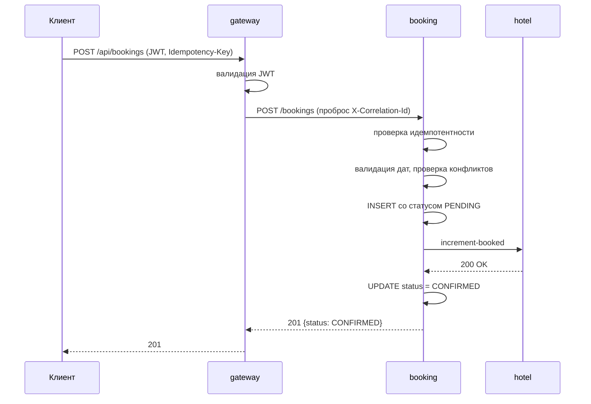
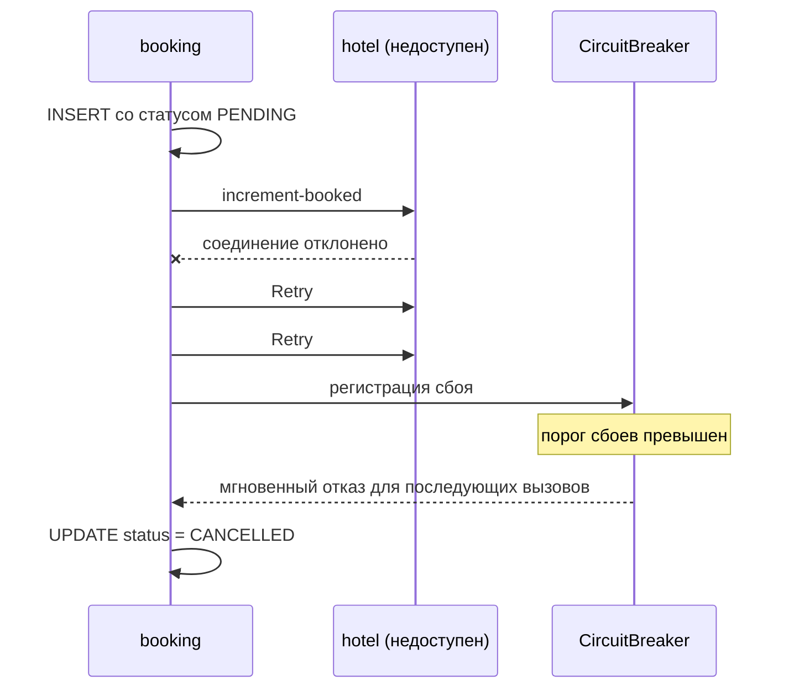
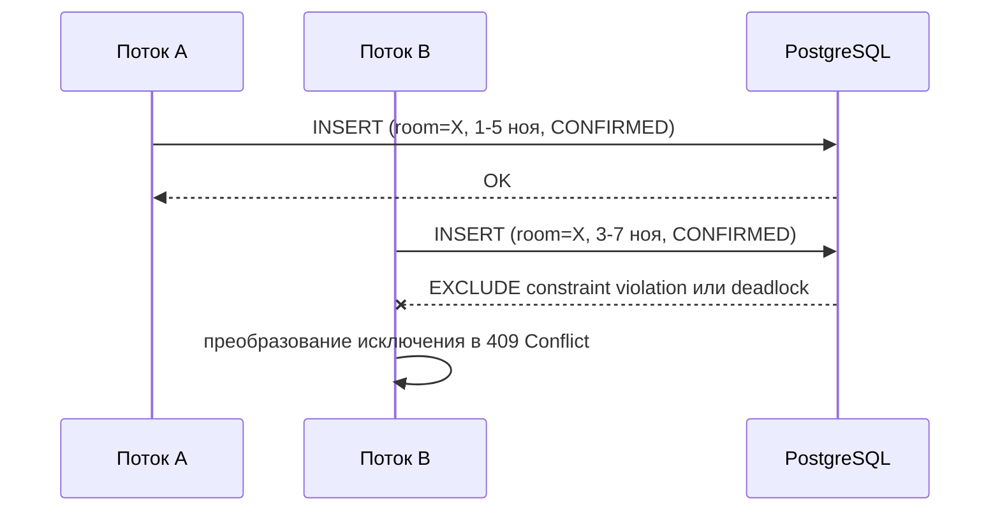

# Архитектура системы

## Обзор

Система реализована как набор независимых сервисов, каждый из которых владеет собственной базой данных (database-per-service). Межсервисное взаимодействие осуществляется по HTTP. Обнаружение сервисов выполняется через Eureka. Внешний трафик проходит через API Gateway, который осуществляет маршрутизацию, валидацию JWT и присвоение correlation ID.

## Компоненты

### discovery-service (Eureka)

Реализует паттерн Service Registry. Все прикладные сервисы регистрируются при старте и периодически отправляют heartbeat. Gateway использует Eureka для резолвинга `lb://<service-name>` в конкретный экземпляр с учётом балансировки нагрузки.

Развёртывание single-node. Для проекта достаточно одного узла; конфигурация peer replication не требуется.

### gateway-service

Реализован на Spring Cloud Gateway (реактивный стек WebFlux). Выполняет следующие функции:

- **Маршрутизация.** Определены три маршрута (`/api/auth/**`, `/api/hotels/**`, `/api/bookings/**`), каждый направляется в соответствующий downstream-сервис через `lb://`. Фильтр `StripPrefix=1` удаляет префикс `/api` перед передачей запроса в сервис.
- **Валидация JWT.** Реализован `ReactiveJwtDecoder` (Nimbus, HS256). Запросы без валидного токена отклоняются до передачи в downstream.
- **Correlation ID.** Фильтр `TraceIdFilter` извлекает `X-Correlation-Id` из входящего запроса или генерирует новый, добавляет его в заголовки исходящего запроса и в ответ клиенту.
- **Обработка ошибок.** `GatewaySecurityErrorHandler` (для 401/403) и `GatewayExceptionHandler` (для остальных исключений) возвращают ответы в едином формате `ErrorDTO`.
- **Агрегация документации.** Gateway собирает спецификации OpenAPI (Swagger) от `auth`, `hotel` и `booking` сервисов по специальным маршрутам (`/api/*/v3/api-docs`) и предоставляет единый интерфейс Swagger UI для разработчиков.

Публичные маршруты без аутентификации: `/api/auth/register`, `/api/auth/login`, `/actuator/health`, `/actuator/info`, `/error`.

### auth-service

Сервис аутентификации. Не выполняет роль Resource Server — только выдаёт токены. Реализованы:

- Регистрация пользователя с проверкой уникальности email и валидацией пароля.
- Аутентификация по email и паролю.
- Генерация JWT (HS256) с claims `sub`, `uid`, `role`, `exp`, `iss`.

Пароли хранятся в виде BCrypt-хешей (cost 10). Секретный ключ JWT передаётся через переменную окружения `JWT_SECRET`, общую для всех сервисов.

`auth-service` намеренно не валидирует JWT: сервис отвечает за выпуск токенов, а не за проверку доступа. Валидация возложена на каждый прикладной сервис.

### hotel-service

Источник истины для отелей и номеров. Реализован как Resource Server.

Основные функции:
- CRUD отелей и номеров с проверкой прав (изменяющие операции — только `ADMIN`).
- Поиск с фильтрами (по городу, звёздности, вместимости, цене) через `JpaSpecificationExecutor`.
- Пагинация результатов.
- Расчёт статистики загруженности отеля: количество номеров, общее число бронирований, среднее число бронирований на номер, диапазон цен, топ-5 номеров по загруженности.
- Эндпойнт `/rooms/available` возвращает номера, отсортированные по `times_booked ASC, id ASC`. Используется `booking-service` при автоматическом выборе номера.
- Эндпойнты `/increment-booked` и `/decrement-booked` для атомарного обновления счётчика `times_booked` со стороны `booking-service`.

### booking-service

Оркестратор саги. Хранит бронирования в собственной БД. Реализован как Resource Server.

Жизненный цикл бронирования:
1. Получение запроса на создание.
2. Проверка идемпотентности (при наличии `Idempotency-Key`).
3. Валидация дат и проверка конфликтов на уровне БД.
4. Создание записи в состоянии `PENDING`.
5. Вызов `incrementBooked` в `hotel-service` через `HotelResilientClient` (Retry + CircuitBreaker + Timeout).
6. При успехе — перевод в `CONFIRMED`, при сбое — в `CANCELLED`.

Обработка ошибок:
- `DataIntegrityViolationException` — нарушение `EXCLUDE` constraint или дубликат `Idempotency-Key` → `409 Conflict`.
- `CannotAcquireLockException` — deadlock при параллельных вставках → `409 Conflict`.
- `RuntimeException` от Feign — сбой downstream → компенсация и `CANCELLED`.

### common

Общая библиотека, подключаемая в servlet-сервисы. Содержит:
- `ErrorDTO` и `ErrorCode` — унифицированный формат ошибок.
- `GlobalExceptionHandler` — единая обработка исключений в MVC-стеке.
- `JsonSecurityErrorHandler` — реализация `AuthenticationEntryPoint` и `AccessDeniedHandler` для возврата 401/403 в формате `ErrorDTO`.

Активация выполняется через Spring Boot auto-configuration с условием `@ConditionalOnWebApplication(type = SERVLET)`, что исключает конфликт при использовании библиотеки в реактивном `gateway-service` (в нём реализованы собственные WebFlux-компоненты).

## Потоки взаимодействия

### Создание бронирования (успешный сценарий)

### Компенсация при недоступности hotel-service

### Параллельные бронирования (overbooking protection)

Инвариант «не более одной активной брони номера на пересекающиеся даты» гарантируется PostgreSQL через `EXCLUDE USING gist` и не зависит от количества одновременных запросов.

## Синхронность межсервисного взаимодействия

Взаимодействие между `booking-service` и `hotel-service` реализовано синхронно через OpenFeign. Выбран паттерн orchestration-saga, при котором `booking-service` координирует все шаги.

Обоснование выбора:
- Прозрачный контроль последовательности шагов и точек компенсации.
- Простая диагностика — вся цепочка видна в одном сервисе.
- Меньше инфраструктурных зависимостей по сравнению с асинхронной choreography.

Ограничения:
- Блокировка потока на время Feign-вызова.
- `booking-service` становится точкой отказа при недоступности — частично компенсируется Circuit Breaker.

Для высоконагруженных систем была бы предпочтительна eventual consistency через transactional outbox и асинхронную передачу сообщений, однако для задач данного проекта синхронная orchestration обеспечивает достаточный уровень надёжности при существенно меньшей сложности реализации.

## Хранение данных

**Database-per-service.** Каждый прикладной сервис использует отдельную базу данных:
- `booking_auth` — пользователи и учётные данные.
- `booking_hotel` — отели и номера.
- `booking_booking` — бронирования.

Ссылочная целостность между сервисами обеспечивается на уровне приложений:
- `booking.room_id` валидируется `hotel-service` при вызове `increment-booked` (404 при отсутствии номера).
- `booking.user_id` берётся из проверенного JWT, выданного `auth-service`.

Внешние ключи между БД отсутствуют. Это осознанный компромисс: он исключает связанность сервисов через общую схему, но требует дисциплины при удалении данных. Удаление отеля через `DELETE /hotels/{id}` не затрагивает брони в `booking_booking`; для продуктивной системы потребовалась бы soft-delete или синхронизация через события.
