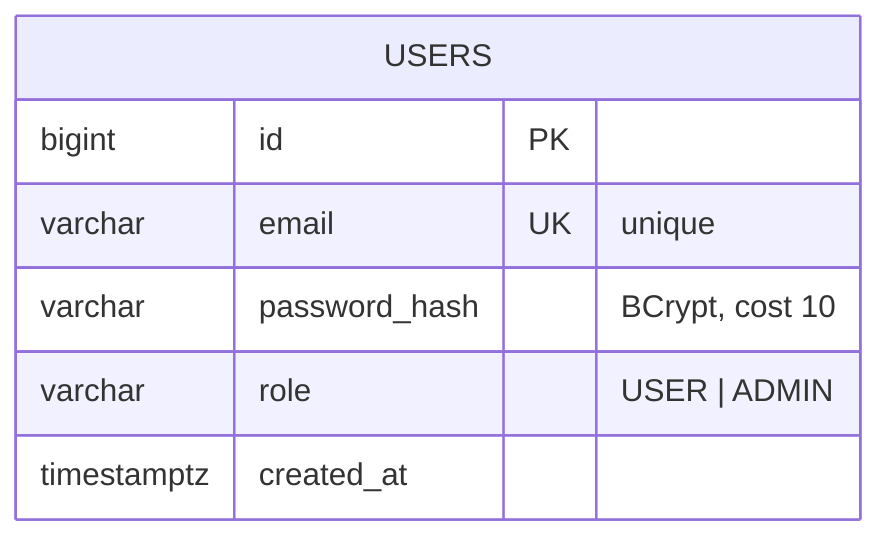
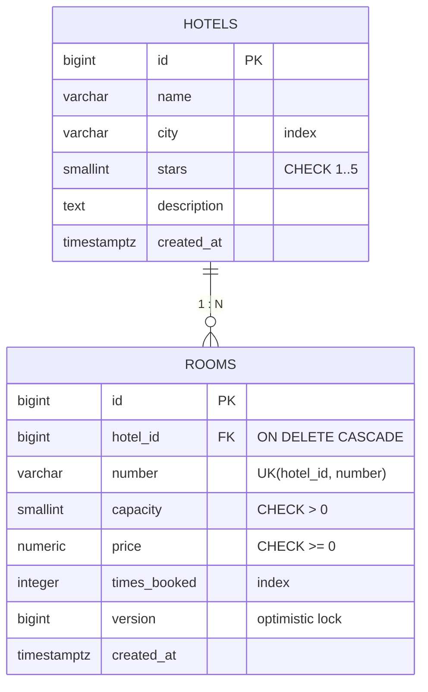
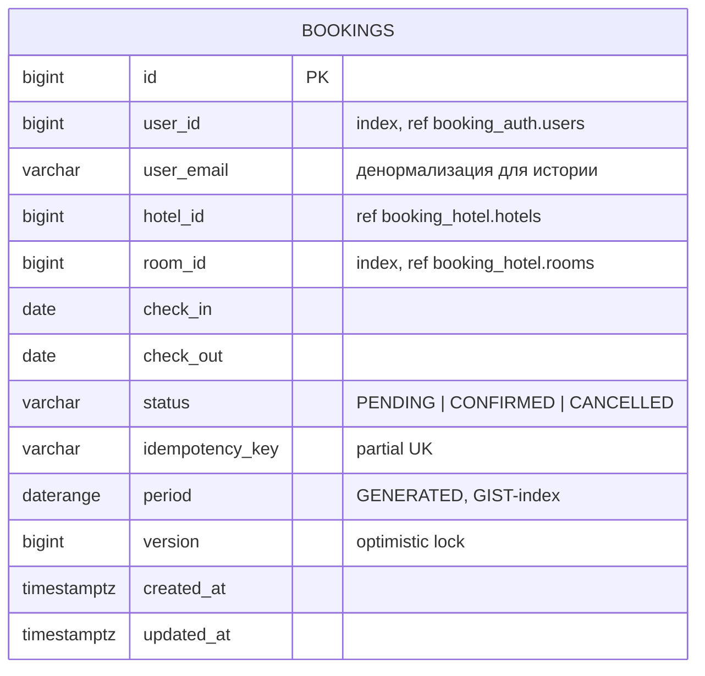

# Модель данных

Система использует три независимые базы данных. Ниже приведены схемы и ключевые ограничения.

## `booking_auth`



Ограничения:
```sql
CREATE UNIQUE INDEX ... ON users(email);
```
Уникальность email обеспечивает идемпотентность регистрации и однозначность аутентификации.

## `booking_hotel`



Индексы и ограничения:
```sql
CREATE UNIQUE INDEX ... ON rooms(hotel_id, number);
CREATE INDEX idx_rooms_hotel_id     ON rooms(hotel_id);
CREATE INDEX idx_rooms_times_booked ON rooms(times_booked);
CREATE INDEX idx_rooms_price        ON rooms(price);
CREATE INDEX idx_hotels_city        ON hotels(city);
CREATE INDEX idx_hotels_stars       ON hotels(stars);
```

Колонка `times_booked` индексируется, так как используется в `ORDER BY` при выборе номера в `booking-service`. Поле `version` обеспечивает оптимистичную блокировку при обновлении счётчика под конкурентной нагрузкой.

## `booking_booking`



Ключевые ограничения:

```sql
-- Инвариант «одна активная бронь номера на непересекающиеся даты»
ALTER TABLE bookings ADD CONSTRAINT no_overlapping_active_bookings
    EXCLUDE USING gist (room_id WITH =, period WITH &&)
    WHERE (status <> 'CANCELLED');

-- Идемпотентность создания
CREATE UNIQUE INDEX unique_idx_bookings_idempotency
    ON bookings(idempotency_key) WHERE idempotency_key IS NOT NULL;

-- Производительность выборок
CREATE INDEX idx_bookings_user_id ON bookings(user_id);
CREATE INDEX idx_bookings_room_id ON bookings(room_id);
CREATE INDEX idx_bookings_status  ON bookings(status);
CREATE INDEX idx_bookings_period  ON bookings USING gist (period);
```

Колонка `period` — генерируемая:
```sql
period DATERANGE GENERATED ALWAYS AS (daterange(check_in, check_out, '[)')) STORED
```

Расширение `btree_gist` создаётся в миграции `V1__create_bookings.sql`.

### Обоснование ключевых решений

**`EXCLUDE USING gist` вместо проверки в коде.** Проверка «есть ли пересечение с активной бронью» на уровне приложения подвержена race condition: два потока могут одновременно выполнить `SELECT` и получить «свободно», после чего оба выполнят `INSERT`. Ограничение `EXCLUDE` — декларативный механизм PostgreSQL, гарантирующий атомарность на уровне БД независимо от количества конкурентных транзакций.

**Частичный уникальный индекс на `idempotency_key`.** Использование `WHERE idempotency_key IS NOT NULL` позволяет оставить существующие записи без ключа (созданные до введения механизма идемпотентности) без нарушения ограничения. Полный уникальный индекс на nullable-колонке в PostgreSQL допускает любое количество `NULL`, но частичный индекс более явно выражает намерение и снижает размер индекса.

**`daterange` вместо двух `DATE` для проверки пересечений.** `EXCLUDE` работает с оператором пересечения `&&`, определённым для `daterange`. Использование range-типа также упрощает чтение и поддерживает полуоткрытый интервал `[)` — дата выезда не считается занятой, что соответствует стандартной гостиничной практике.

**Отсутствие внешних ключей между БД.** Разные базы данных физически не могут содержать FK между собой. Ссылочная целостность обеспечивается:
- `booking.room_id` — проверка на стороне `hotel-service` при `increment-booked`;
- `booking.user_id` — значение из подписанного JWT.

Денормализованное поле `user_email` в `bookings` сохраняет email на момент бронирования. Это осознанное решение: если пользователь сменит email в будущем, исторические брони сохранят исходное значение.
